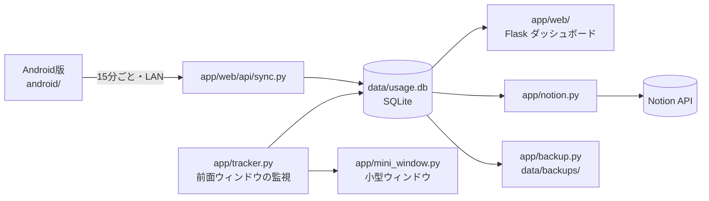

# 設計

## 全体構成



## ディレクトリ構成と各モジュールの責務

```
app/
├── storage/          記録の読み書き
│   ├── constants.py    共有する定数（端末名）
│   ├── dates.py        期間の計算（データベースに触れない）
│   ├── display.py      照合キーと表示名の橋渡し
│   ├── migrations.py   スキーマの定義と移行
│   └── store.py        UsageStore 本体
├── web/
│   ├── api/          REST API（扱う対象ごとに分割）
│   │   ├── blueprint.py  api_bp の定義だけ（循環参照を避けるため）
│   │   ├── helpers.py    各ルートが使う道具と入力の検証
│   │   ├── usage.py      /usage/*
│   │   ├── timeline.py   /timeline /timeline/dates /history
│   │   ├── limits.py     /limits
│   │   ├── status.py     /status /mini-window/* /toggle-pause
│   │   └── sync.py       /sync/*
│   └── __init__.py   アプリの組み立てとアクセス制御
├── tracker.py        計測の本体
├── timeline.py       区間の結合と集計（データベースに触れない）
├── naming.py         アプリ名の照合
├── mini_window.py    小型ウィンドウ
├── backup.py         自動バックアップ
├── config.py         設定
├── window.py         Windows API（アクティブウィンドウ）
├── display.py        Windows API（モニターと座標）
└── notifier.py       通知
```

`storage` と `web/api` は外から見た名前が分割前と同じです
（`from app.storage import UsageStore` はそのまま使えます）。

**SQLite の例外処理は `store.py` の `_guard` に集約しています。**
以前は同じ `try/except` が20か所に写されていました。

```python
@_guard("使用区間の記録に失敗しました ({app_name})")
def add_session(self, app_name, ...):
```

波括弧には引数名を書けます。展開は失敗したときだけ行います。

## データの流れ

- PC: `tracker.py` が前面のウィンドウを一定間隔（既定 5 秒）で確認し、アプリ名を決めて、使用時間を書き出す（既定 60 秒ごと）。
- スマホ: Android版が使用区間を集め、15分ごとに同期 API へ送る。PC は `external_id` で重複を除き、影響を受けた `(端末, 日付)` の合計を区間から計算し直す（[spec.md](spec.md#スマホとの連携)）。
- 表示: Flask のダッシュボードが DB を集計して表示する。
- Notion: 日付が変わったときに、前日分を送る。

## 画面の共通化

3画面（ダッシュボード・タイムライン・履歴）で見せ方を揃えるため、
共通の処理は `static/common.js` に集約しています。
**HTMLの骨組みは `templates/base.html` にあり、各ページは中身だけを書きます。**

| まとまり | 役割 |
|---|---|
| `format` | 時間・日付・文字の整形 |
| `devices` | 端末名の表記（`/api/status` から受け取る） |

**時間や日付の見せ方を変えるときは、このファイルだけを直します。**
以前は3画面が別々に同じ処理を持っており、片方だけ直すと表記がずれていました。

`static/style.css` の `--control-height` は、ヘッダーの高さを画面ごとに
ぶれさせないための基準です。右側にボタンが無い画面でも高さが揃います。

`html { scrollbar-gutter: stable both-edges }` で、スクロールバーの幅を
**左右へ均等に**確保しています。右だけに確保すると、中身が画面の中央から
半分ぶん左へずれます。

**アプリ名は `data/app_names.json` の `display` をそのまま表示します。**
画面側で `.exe` を落とすなどの加工はしません。表示を変えたいときは対応表を編集してください。

**ヘッダー右上は2段です。** 上段が状態表示と操作、下段が日付の切り替えです。
日付操作を持たない履歴でも段だけ確保し、3画面でヘッダーの高さを揃えています。

ヘッダーは**上端揃え**にし、左上のアプリ名と右上1段目のボタンが同じ高さに来るように
しています（`.header-left` の高さを1段ぶんに揃えている）。
ヘッダー全体の高さは、常に2段ある右側が決めます。

| 部品 | ファイル | 動作 |
|---|---|---|
| 状態・ミニウィンドウ・一時停止 | `templates/_status_controls.html` | `common.js` の `statusBar` |
| 日付の切り替え | `templates/_date_controls.html` | `common.js` の `dateBar` |

**ダッシュボードとタイムラインは日付を切り替えられます。** 日付に依存するAPIは
`?date=` を受け取り、省略すると今日になります。ダッシュボードの日／週／月は
選んだ日を含む期間を示し、**まだ来ていない日付は含めません**（今週なら月曜〜今日）。

**ヘッダー右上の状態表示と操作は3画面共通です。** 計測中かどうか、ミニウィンドウ、
一時停止は `templates/_status_controls.html` に置き、各画面から読み込んでいます。
動作は `common.js` の `statusBar` が持ち、15秒ごとに状態を確認します。

**履歴はアプリで絞り込めます。** ヘッダーの選択欄で選ぶと、そのアプリだけの
推移になります（`/api/history?app=`）。選択肢は絞り込む前の全体から作るため、
選んだあとも候補は減りません。

**ダッシュボードの統計欄は、日／週／月の切替と日付に連動します。**
実時間・アプリ数・超過はいずれも期間の解釈が要るため、`/api/usage/summary` が
まとめて求めます（画面側で足し上げると同時使用が二重に数えられ、
制限の判定も日ごとに見る必要があるため）。

**超過は「その期間に1日でも制限を超えたアプリの数」**です。制限は1日あたりの
時間なので、期間の合計ではなく日ごとに判定します。判定はこのPCの使用時間だけで
行い、通知を出すトラッカーと基準を揃えています。

**セクションの見出しには対象期間を出します。** ダッシュボードは日／週／月の切替に
連動し、タイムラインはその日付、履歴は「直近30日間」を示します。
期間の区切り方（週は月曜始まり・月は1日始まり）はサーバー側だけで決めており、
`/api/usage/<period>` が開始日と終了日を返します。画面側では計算しません。
「制限時間」は期間を持たない設定欄のため、名前のままです。

## 外部依存

| 依存 | 用途 |
|---|---|
| Flask | ダッシュボードと API |
| SQLite（標準ライブラリ） | 使用時間の記録 |
| Windows の API | 前面のウィンドウ・実行ファイルの情報の取得 |
| Notion API | 日次登録（任意） |
| Android（Kotlin / Jetpack Compose、UsageStats） | スマホの使用状況の取得と送信 |

Python の依存の一覧は `requirements.txt`（版を固定）と `requirements-dev.txt`。
